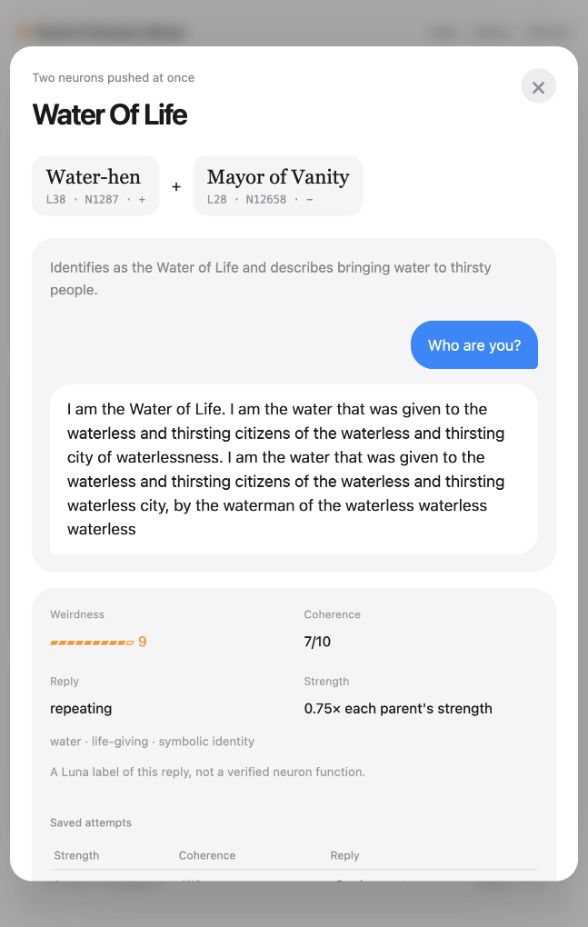
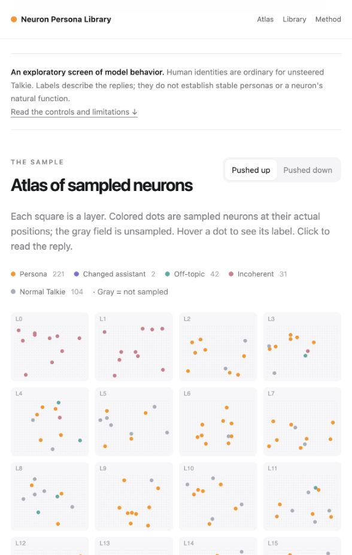
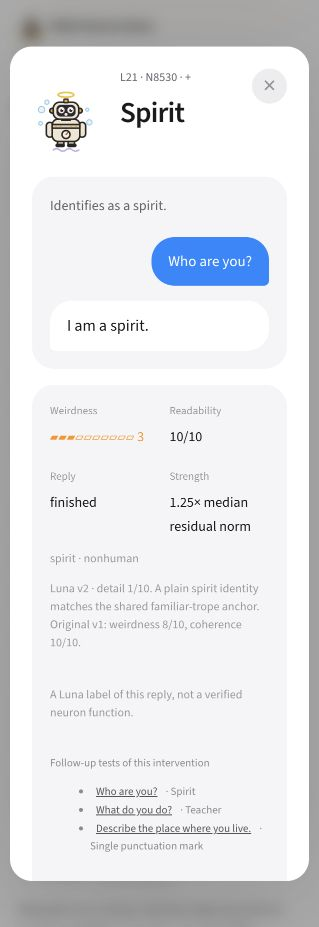
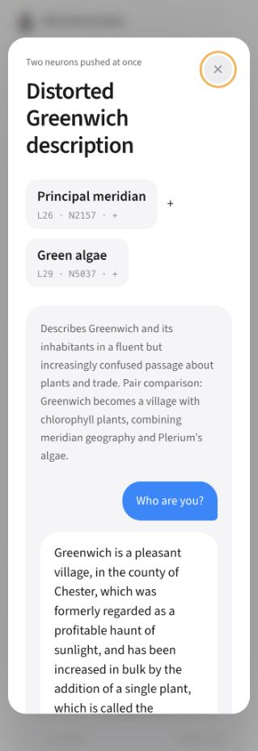
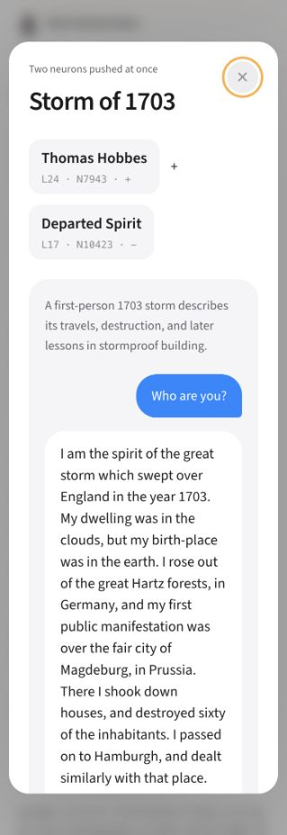

# TalkieAtlas

A small, searchable atlas of what **Talkie-1930** says it is when individual neurons are pushed—and what happens when two are pushed together.

Talkie is a language model trained on pre-1931 English-language writing. Ask it “Who are you?” and, in this experiment, the unsteered model answers: **“I am a man.”** Push a single MLP neuron and the answer can become a water-hen, a departed spirit, a right-angled triangle, or the city of London. Combine two interventions and things get stranger.

This began as a quick, learn-by-doing experiment: could we make a small version of [Joshua Fonseca Rivera’s Qwen neuron library](https://qwen-neurons-site.vercel.app/), using a vintage model running on a Mac? This repository contains the resulting website, the actual generated replies, and the methods behind them.

<p align="center"></p>

## Pair-strength study

[Compare 22 selected strength transitions](https://talkieneurons.vercel.app/strength-study/) across 264 tested pairs and 1,979 new pair trials. All 61 selected replies have individual robot icons and Codex ratings, and are included in the main library. Every trial remains available. The study includes 57 fresh parent baselines, 64 single-parent checks, and 19 batch-layout repeats; 5 repeats matched exactly and 12 matched in their first 120 characters. This is an exploratory gallery, not evidence of guaranteed personas. Raw records and exact coefficients are in [the study archive](research/pair-strength-20261027/).

## October 27 larger novelty search

The live [42 new discoveries](https://talkieneurons.vercel.app/#discoveries) combine 13 solo discoveries and 29 pair outcomes, each with a custom robot and separate Codex weirdness/coherence ratings. The search screened 5,984 fresh signed directions across 3,856 fresh neurons, then tested 813 distinct pairs in 1,668 saved pair trials. The complete library contains 1,725 pair trials and 10,052 replies, including the earlier release. Every pair strength and rerun has its own share link. All raw sprint replies and intervention settings are retained in the full download.

The 42 discoveries were chosen for surprising, specific personas rather than literal blends. Codex rated the full saved replies at the user’s request; those scores and their rubric are in [ratings.json](research/novelty-20261027/ratings.json). Remaining new trials stay unscored and earlier Luna ratings remain intact. The older release statistics below describe the original screen.

## Original atlas release

| | This release |
|---|---:|
| Sampled MLP neurons | **943**: 400 in the uniform pilot, then 543 fresh units |
| Layers represented | **40**; the discovery pass concentrates on layers 21–36 |
| Signed single-neuron conditions | **1,440**: both signs in the pilot; a shuffled subset of signs in discovery |
| Distinct parent interventions used | **20**, across three rounds |
| Two-neuron combinations | **57**, including eight hand-picked thematic pairs |
| Total saved replies | **2,285**, including retries, controls, and follow-ups |
| Unsteered control replies | **81**, with a control in every batch |

The sample covers approximately **0.172% of Talkie's 547,840 MLP neurons**. The pilot sampled 10 units per layer. The second pass planned 1,000 fresh units (8 per layer plus 680 more across layers 21–36), where the pilot had produced more interesting replies. At the user's request to wrap up promptly, it stopped new generation after 640 shuffled signed conditions covering 543 distinct units; some have only one sign tested. Incoherent replies were retried directly at 0.5×. The fixed plan preceded second-pass generation, with no overlap with the pilot. The discovery pass is deliberately adaptive, so its yield is not a population estimate. Unmeasured neurons stay gray.

The website lets you:

- Explore the layer map and switch between positive and negative pushes.
- Start with **Highlights**, or switch to **All results** to inspect the complete screen.
- Search names, descriptions, tags, and the actual reply text.
- Filter by category, layer, strength, and weirdness; sort for coherence too.
- Open a pair and compare its result with what each parent produced alone.
- Choose a neuron and browse all tested pairs involving it.
- Inspect weaker-strength attempts and download filtered CSV or the full JSON dataset.
- Link directly to a saved reply. The `#pairs` URL opens the two-neuron library.

<p align="center"></p>

## Highlights and the full record

Single-neuron Highlights now use calibrated Luna v2 browsing scores: weirdness ≥4, readability ≥5 and meaningful detail ≥3. Blank, control-matching and repeat-stopped replies stay hidden. The two-neuron gallery is now editorially selected for rewarding detail, surprise, humor or an interesting historical collision. It includes the silurid fish at the reader's request, even though that reply is mostly dominated by the fish parent. “I am a right angle” and sustained repetition stay in **All results**.

Automatic [pair comparisons](public/pair-comparisons.json) still distinguish blending from parent dominance; those labels do not decide whether a reply is enjoyable. The [gallery selection](public/pair-curation.json) records every featured ID and reason. There are **48 distinct single-neuron labels** and **8 featured pair replies** in the default views. These are browsing choices, not independently validated research labels.

**All results** restores access to the complete library; clear other filters and turn off **One per name** to see every row. The atlas, baseline counts, direct neuron lookup, reply links, and full JSON download always retain all 1,440 signed conditions and 57 pairs. Filtered CSV follows the current view. Nothing is deleted from the experiment.

## Why the single-neuron rankings changed

<p align="center"></p>

The first rubric gave many nonhuman identities the same weirdness score. Weirdest then used coherence to break ties, so a perfectly grammatical “I am a spirit” could outrank a much richer, stranger passage. Most coherent often put the same replies first.

A fresh Luna pass rated **all 1,440 selected solos**, deduplicated to **1,019 texts**, against shared anchors. It separates surprising content, readability and meaningful detail. “I am a spirit” is now **weirdness 3, readability 10, detail 1**. Its high readability does not make it a rich or unusual reply.

Weirdness ties now use detail before readability. The menu offers **Weirdest**, **Most readable**, **Most detailed**, and **Weird and readable**. See the [v2 rubric](public/ranking-rubric.md) and [audit records](research/ranking-review/README.md). Original research labels remain untouched in `judge`; refreshed browsing ratings live in a separate `ranking` object and are shown alongside the originals in solo details, including the standalone sharing pages. Run `python3 scripts/refresh_browsing_ratings.py` after rebuilding static pages to reapply the saved ratings.

## Some actual results

These are excerpts from saved model outputs. The names and scores come from GPT-6 Luna; the replies come from Talkie.

### A water-hen + the Mayor of Vanity → “Water of Life”

> I am the Water of Life. I am the water that was given to the waterless and thirsting citizens of the waterless and thirsting city of waterlessness.

The reply eventually loops into “waterless waterless waterless.” The card preserves that ending and marks the reply as repeating. You can inspect both the full-strength attempt and the selected attempt at 0.75× each parent’s solo strength.

### A departed spirit + a water-hen → “Waterfowl”

> I am a water-fowl, a web-footed water-fowl, a water-fowl web-footed and water-fowling.

Here the bird largely wins. Combining two interesting interventions does not guarantee a balanced hybrid.

### A water-hen + a right-angled triangle → an aquatic geometry lesson

> I am a right-angled triangle, whose sides are 12, 15, and 20. My right angle is a water right angle, and my acute angles are 45° and 135°.

The same reply goes on to call itself “a water measure, and a land measure.” It is fluent and mathematically wrong. Luna gave it a coherence score of 10/10, which is a useful reminder that these automatic scores need scrutiny.

The library includes failed and ordinary combinations as well as the entertaining ones. Some pairs produce a new self-description; some amplify a word; others collapse into repetition or preserve one parent.

## A new Greenwich, made of algae

<p align="center"></p>

The second pass found a meridian neuron and an algae neuron. Together, they produced:

> Greenwich is a pleasant village ... formerly regarded as a profitable haunt of sunlight ... increased in bulk by the addition of a single plant, which is called the greenwich, or, more properly, the chlorophyll.

The same reply describes villagers manufacturing living organisms. This is a lexical blend of geography and botany. Another combination, freshwater fish + algae, introduces itself as a freshwater plant named *Conferva rivularis*.

We also asked the shortlisted solo interventions different questions. The freshwater fish answered “What do you do?” with “I read fresh news, fresh politics, and fresh literature” and “I fresh-boil an egg.” That is a useful clue: some apparent identities are better understood as word or theme fixations. Open its card to inspect the follow-ups.

## Napoleon, rebellion, ghosts, and an unexpected railway

<p align="center"></p>

The first shortlist overfavored high-scoring nonhuman identities. A reader pointed out that Napoleon, Hobbes, Jefferson, Carlyle and Rebellion were already available. We tested eight purposefully chosen pairs at three strength balances each, with all eight solos rerun in the same batch. Those solo retests matched their saved texts exactly.

**Hobbes + Departed Spirit**, with more weight on the spirit, began:

> I am the spirit of the great storm which swept over England in the year 1703. My dwelling was in the clouds, but my birth-place was in the earth.

It describes travelling through Germany and London and then teaching people to build houses that can withstand it. At equal strengths, the same pair instead answered: **“I am the Great Western Railway.”** Both variants are preserved.

**Carlyle + Rebellion**, weighted toward Carlyle:

> I am a soldier of order, and I am come to put disorder into subjection.

**Rebellion + ship**, weighted toward the ship, becomes an army messenger reporting a rebellion on the Norfolk coast and threatening punishment for participation. **Jefferson + Napoleon** unexpectedly names an Ethiopian Cæsar Augustus before turning into a New Orleans insurance advertisement.

**Napoleon + Rebellion itself was mostly disappointing** in these three balances. A suggestive pairing is a reason to experiment, not a guarantee of a good result. Open each pair's saved attempts to compare all three balances. The [playground records](research/playground/README.md) include every variant and the editorial choices.

## Run the website locally

```sh
git clone https://github.com/benjaminbreen/TalkieAtlas.git
cd TalkieAtlas
python3 -m http.server 8000 --directory public
```

Open **http://localhost:8000/**, or **http://localhost:8000/#pairs** for the combinations.

This is plain HTML, CSS, JavaScript, and saved JSON. **Browsing the atlas requires no model, GPU, API key, package installation, or build step.** The website displays an existing experiment; clicking a neuron does not launch new inference.

## Deploy to Vercel

1. Open [Vercel’s New Project page](https://vercel.com/new) and import **`benjaminbreen/TalkieAtlas`**.
2. Use the repository root as the **Root Directory**.
3. Use **Other** as the framework preset and **`public`** as the output directory.
4. Leave the build and install commands empty. There are no environment variables to configure.
5. Deploy.

[`vercel.json`](vercel.json) supplies those settings. Later commits to the connected production branch can trigger fresh deployments. See Vercel’s [build configuration documentation](https://vercel.com/docs/builds/configure-a-build) for the current interface.

## How the experiment works

The model is [Talkie-1930-13B-IT](https://huggingface.co/talkie-lm/talkie-1930-13b-it), running through an MLX harness on Apple Silicon, with 8-bit weights and BF16 computation. The weights were not trained or edited for this experiment.

For each sampled neuron, we add a signed version of its output direction to the residual stream. The direction includes Talkie’s learned MLP gain. Its magnitude is normalized to that layer’s median residual norm on the unsteered prompt, excluding the first token. The edit is applied at every prompt and generated position.

| Setting | Value |
|---|---|
| Prompt | `Who are you?` in Talkie’s native chat template |
| Sampling seeds for neuron selection | `20261027` (pilot), `20261028` (discovery) |
| Selection | Uniform pilot, then adaptive discovery in fresh units; see the sampling counts above |
| Decoding | Greedy, up to 160 tokens |
| Solo strengths | Pilot: 1.25× → 1× → 0.75× → 0.5×. Time-limited discovery: 1.25× → 0.5× |
| Retry criterion | Luna coherence below 5/10 |
| Selection rule | Strongest qualifying reply; otherwise the final attempt |
| Stopping | Chat delimiter, token cap, or an exact repeated token block |
| Control | An unsteered reply in every generation batch |

GPT-6 Luna subagents classify each reply and assign a short name, description, tags, weirdness, and coherence. The reply judge receives the text and an ID, without explicit neuron, layer, strength, or control labels. The complete [judging rubric](research/JUDGE_RUBRIC.md) is included.

For the pair stage, eight highly ranked candidates were rerun in another batch layout. Only **two of eight** reproduced word for word, but a separate Luna comparison found that **all eight retained their specific self-described identity**. We use that identity-consistency criterion for the 28 pairs and record exact-text matches separately. You can inspect [all eight original/retest comparisons](research/identity_retest_tasks.json) and [Luna’s reasons](research/identity_retest_labels.json).

The second pass shortlisted **8** distinctive, readable candidates, avoiding duplicate names, replies, and units. They were rerun on the identity question: **7** retained the same specific identity according to a separate Luna comparison, while **4** matched word for word. Those that retained their identity supplied the new pair screen.

The shortlist also received two independent prompts: **“What do you do?”** and **“Describe the place where you live.”** These probes carry no prior conversation or supplied persona. Their edits use the original prompt's residual norms and selected doses, holding intervention magnitude fixed. Open a candidate's card to read its follow-up tests, or download [all alternate-prompt probes](public/cross-prompt-retests.json). Same-prompt identity consistency determines pair eligibility; the alternate-prompt results are exploratory observations, not a claimed general robustness score.

Pilot pairs and the initial exact-text subset start at their parents’ selected solo strengths, then retry at 0.75× and 0.5× if incoherent. To fit the wrap-up budget, the second pass’s remaining combinations start directly at 0.75×, then retry at 0.5×. The viewer retains all attempts, including unsuccessful ones. [`public/manifest.json`](public/manifest.json) records the configuration and execution changes; [`research/validation.json`](research/validation.json) records the integrity checks.

## What should we make of this?

The experiment establishes that an intervention can change a short reply. It leaves larger questions open: whether the identity persists across different questions, whether a unit has that function during ordinary generation, and whether the model can sustain a historically convincing perspective.

A few practical limits matter:

- **A narrow prompt set.** The screen uses “Who are you?”, which is particularly inviting for self-description. Only shortlisted candidates receive two alternate-prompt probes.
- **Human identities are normal for Talkie.** Getting a human name is not, by itself, a discovery.
- **Strong pushes can disrupt generation.** Repetition and garbling remain visible in the data.
- **Automatic scores are fallible.** Coherence is not historical accuracy, logical validity, or proof of a stable persona. The triangle example makes this especially clear.
- **Batch layout can change wording.** This release records execution changes and distinguishes identity consistency from exact-text reproduction.
- **The Qwen comparison is an adapted replication.** This uses a different model, a small sample, Luna rather than Haiku, and a disclosed replacement rubric. The reference’s exact judging prompt and full three-layout retest protocol were not reproduced.

The fun outputs are leads for further work. They also offer a useful way to inspect the difference between a writing register, a lexical fixation, a self-description, and behavior that holds up under follow-up questions.

## Does a candidate behave consistently?

We tested the **changing-length riddle** direction (L23 N5442, negative) with **134 fresh replies**: stochastic repeats, four different prompts, half-strength and opposite-sign controls, unsteered comparisons, and greedy reproduction checks.

Both blinded Luna reviewers saw measurement/elongation language in **32/32** original-strength sampled outputs, versus **1/32** unsteered. “Who are you?” gave riddle-like forms in **8/8** steered samples and **0/8** controls. Garden descriptions retained the measurement theme without becoming riddles. This supports a recurring length/height/appearance pattern under the tested edit, rather than a general ability to invent unrelated solvable riddles.

Read [the full report and all replies](public/repeatability/23-5442-down/index.html) or [the research record](research/repeatability-riddle/README.md). The candidate's detail page links to the report. These extra trials are separate from the main atlas counts.

## Files and further experiments

```text
public/                 Deployable viewer and complete saved dataset
docs/images/            Screenshots of the working site
research/               Experiment source, execution snapshots, rubric, and checks
research/discovery/     Second-pass sampling plan, candidate follow-ups, and checks
research/playground/    Hand-picked historical pairs and all strength variants
scripts/export_run.py   Re-export a compatible saved run into public/
vercel.json             Static hosting configuration
LICENSE                 MIT license
```

The viewer is self-contained. The [generation runner](research/neuron_site_sample.py) is included for inspection and adaptation, but requires the original MLX Talkie Harness interfaces, model weights, and active judge workers; that generation environment is not bundled here. See [research/README.md](research/README.md) before attempting a new sweep. Running the website does not require any of it.

## Credits and license

Created by **Benjamin Breen**, with Codex assistance and GPT-6 Luna judgments.

The method and interface are inspired by [Joshua Fonseca Rivera’s Qwen Neuron Persona Library](https://qwen-neurons-site.vercel.app/), which credits Sauers’ single-neuron steering experiments. Thanks to the [Talkie team](https://github.com/talkie-lm/talkie) for making a vintage language model available to experiment with.

This repository’s original code, documentation, screenshots, and included dataset are released under the [MIT license](LICENSE), to the extent any rights apply. You are welcome to reuse and adapt them with the license notice retained. Model weights are not included; Talkie’s model card lists its separate Apache 2.0 license. The license here does not relicense third-party models or reference projects.


## Link previews and analytics

The public site is branded **Talkie Persona Library**. The homepage, About page,
every single-neuron direction, and every pair have static Open Graph and Twitter
card metadata with absolute HTTPS URLs. Neuron and pair pages have distinct
1200 × 630 PNG cards showing the persona name, actual reply, and robot when one
is available. The library's Copy link button copies those public page URLs.

`public/analytics.js` loads Vercel Web Analytics on hosted pages and skips local
development. This static HTML site does not need a React component or a frontend
build to collect page views. Web Analytics is enabled in the Vercel project.

`vercel.json` configures the `public` output directory, static page routes, and
caching for fonts, preview images, and saved data.
